# KKS Online: Architecture Diagrams

Companion to [plan.md](plan.md). Target: **~1,000 registered users, 50–100 active at once, ~$2/month + domain.**

**How to view:** these are Mermaid diagrams.
- **GitHub** draws them automatically when you open this file.
- **VS Code:** install the extension *Markdown Preview Mermaid Support* (`bierner.markdown-mermaid`), then open the preview (`Ctrl+Shift+V`).
- **Any browser:** paste one diagram block into [mermaid.live](https://mermaid.live) to zoom, pan and export as PNG/SVG.

Diagrams render at full size (not shrunk to the page width), so scroll sideways on the wide ones.

| # | Diagram | Shows |
|---|---|---|
| 1 | [System overview](#1-system-overview) | Every component, provider and connection |
| 2 | [Four cache layers](#2-how-a-request-is-answered-four-cache-layers) | Why browsing almost never touches the database |
| 3 | [First visitor of the morning](#3-first-visitor-of-the-morning-database-asleep) | What happens when the free database is asleep |
| 4 | [Product search](#4-product-search) | Debounce, caching, trigram index, typo tolerance |
| 5 | [Checkout](#5-checkout-no-overselling) | Transaction, row locks, stock ledger, idempotency |
| 6 | [Admin login](#6-admin-login-and-an-admin-request) | fixed accounts, session cookie, roles |
| 7 | [Stock changes](#7-every-stock-change-goes-through-one-function) | All stock changes through one function |
| 8 | [Order state machine](#8-order-state-machine) | Allowed status changes |
| 9 | [Data model](#9-core-data-model) | Core tables after the cleanup |
| 10 | [Security layers](#10-security-layers-of-one-request) | Every check one request passes |
| 11 | [What wakes the database](#11-what-wakes-the-database-free-compute-budget) | The Neon free compute budget |
| 12 | [Environments and deployment](#12-environments-ci-and-deployment) | Dev, staging, production, CI, backups |
| 13 | [Production cutover](#13-production-cutover-day) | The switch from Supabase, with rollback |
| 14 | [Delivery timeline](#14-delivery-timeline) | The 13 phases over ~16 weeks |

---

## 1. System overview

```mermaid
%%{init: {"theme": "default", "themeVariables": {"fontSize": "20px"}, "flowchart": {"useMaxWidth": false, "wrappingWidth": 340, "nodeSpacing": 55, "rankSpacing": 85, "curve": "basis", "htmlLabels": true}}}%%
flowchart TB
    subgraph USERS["USERS: ~1,000 registered, 50–100 active at the same time"]
        direction LR
        SHOP["🛒 <b>Shoppers (web)</b><br/>browser<br/>browse · search · cart · checkout"]
        ADM["🧑‍💼 <b>Admins</b><br/>owner · manager · staff<br/>orders · catalog · stock"]
    end

    subgraph CF["CLOUDFLARE (free plan)"]
        direction TB
        DNS["🌐 <b>DNS + TLS + DDoS protection</b><br/>yourdomain · api. · admin. · cdn.<br/>1 free rate-limit rule (login, checkout)"]
        EDGE["⚡ <b>Edge cache for the API</b><br/>only public catalog GETs<br/>fresh 60 s · stale up to 10 min<br/>never caches cart / orders / auth / admin"]
        PAGES_S["🖥️ <b>Cloudflare Pages: Storefront</b><br/>React 18 + Vite (static files)<br/>moved from Vercel"]
        PAGES_A["🛠️ <b>Cloudflare Pages: Admin dashboard</b><br/>React 18 + Vite + shadcn/ui<br/>TanStack Query + Table"]
        R2PUB["🖼️ <b>R2 bucket: kks-public</b><br/>served at cdn.yourdomain<br/>product, brand, category images<br/>WebP · cached for 1 year"]
        R2PRIV["🔒 <b>R2 bucket: kks-private</b><br/>payment receipts (signed URLs, 5 min)<br/>encrypted nightly DB backups"]
    end

    subgraph FLY["FLY.IO: Singapore (sin) · 1 always-on machine · shared CPU, 256 MB · ~$2/month"]
        direction TB
        MW["🧱 <b>Middleware</b><br/>helmet · CORS allowlist · real client IP<br/>rate limits · Cache-Control headers<br/>request ID · 15 s timeout"]
        PUB["🛍️ <b>Public + customer routes</b><br/>products · search · categories · brands<br/>collections · cart · checkout · orders<br/>customer login = Google + backend JWT"]
        AUTH["🔑 <b>Admin sign-in</b><br/>/api/v1/admin/auth<br/>fixed accounts from server settings<br/>bcrypt · HTTP-only session cookie"]
        ADMIN["📋 <b>Admin modules</b><br/>requireAdmin(role) · zod validation<br/>products · orders · inventory · customers<br/>reviews · settings · AI · audit log"]
        CACHE["🧠 <b>In-memory cache</b><br/>node-cache · catalog 30 min · search 60 s<br/>single-flight · stale-on-error"]
        STOCK["📦 <b>applyStockChanges()</b><br/>one transaction · row locks<br/>writes the inventory ledger"]
        JOBS["⏱️ <b>/internal/jobs</b><br/>protected by X-Jobs-Secret<br/>reservations · retention · usage"]
    end

    subgraph NEON["NEON POSTGRES: Singapore · free plan"]
        direction LR
        PGMAIN[("🗄️ <b>Branch main = PRODUCTION</b><br/>0.25 CU fixed · 0.5 GB<br/>sleeps after ~5 min idle<br/>pooled connections · role app_rw")]
        PGDEV[("🧪 <b>Branch dev</b><br/>sanitized copy of production<br/>for building and testing")]
    end

    subgraph EXT["EXTERNAL SERVICES"]
        direction TB
        OAI["🤖 <b>OpenAI gpt-4o-mini</b><br/>product description drafts<br/>key only on the server"]
        GOOG["🔐 <b>Google Sign-In</b><br/>customer login"]
        SENTRY["🚨 <b>Sentry (free)</b><br/>errors from API, storefront, admin"]
        UPT["📈 <b>Uptime monitor (free)</b><br/>calls /health every 5 min<br/>never touches the database"]
    end

    subgraph GH["GITHUB"]
        direction TB
        CI["⚙️ <b>GitHub Actions: CI/CD</b><br/>typecheck · lint · tests · build · deploy"]
        CRON["🕒 <b>GitHub Actions: schedules</b><br/>nightly backup · reservations every 10 min<br/>daily usage check · monthly retention"]
    end

    subgraph LEGACY["LEGACY: only until cutover (Phase 11)"]
        direction LR
        OMGX["🗑️ <b>OMGx Flutter admin</b><br/>retired at cutover"]
        SUPA[("🗑️ <b>Supabase</b><br/>current database + storage<br/>deleted 90 days after cutover")]
    end

    SHOP --> DNS
    ADM --> DNS
    DNS --> PAGES_S
    DNS --> PAGES_A
    DNS --> R2PUB
    DNS --> EDGE
    EDGE -->|"cache miss or<br/>personal request"| MW
    MW --> PUB
    MW --> AUTH
    MW --> ADMIN
    PUB --> CACHE
    ADMIN --> CACHE
    CACHE -->|"only on a miss"| PGMAIN
    PUB -->|"checkout"| STOCK
    ADMIN -->|"receive · cancel · adjust"| STOCK
    STOCK --> PGMAIN
    ADMIN --> PGMAIN
    JOBS --> PGMAIN
    ADMIN -->|"upload → sharp → WebP"| R2PUB
    PUB -->|"payment receipt"| R2PRIV
    ADMIN -->|"purge changed URLs"| EDGE
    ADMIN -->|"draft description"| OAI
    PUB --> GOOG
    MW -.->|"errors"| SENTRY
    UPT -->|"/health"| MW
    CRON -->|"X-Jobs-Secret"| JOBS
    CRON -->|"pg_dump, read-only role"| PGMAIN
    CRON -->|"encrypted dump"| R2PRIV
    CI -->|"deploy API"| FLY
    CI -->|"deploy sites"| PAGES_S
    CI --> PAGES_A
    CI -->|"tests"| PGDEV
    OMGX -.->|"writes directly, until cutover"| SUPA
    SUPA -.->|"final dump at cutover"| PGMAIN

    classDef user fill:#E8F1FF,stroke:#2F6FDB,stroke-width:2px,color:#0B2A5B
    classDef cf fill:#FFF1E0,stroke:#F38020,stroke-width:2px,color:#5A2D00
    classDef fly fill:#F1ECFF,stroke:#7B5CF5,stroke-width:2px,color:#2A1A66
    classDef db fill:#E6F8F0,stroke:#0F9D6B,stroke-width:2px,color:#063D29
    classDef ext fill:#F4F4F5,stroke:#71717A,stroke-width:2px,color:#18181B
    classDef legacy fill:#FDECEC,stroke:#D64545,stroke-width:2px,stroke-dasharray:6 4,color:#5B1111
    class SHOP,ADM user
    class DNS,EDGE,PAGES_S,PAGES_A,R2PUB,R2PRIV cf
    class MW,PUB,AUTH,ADMIN,CACHE,STOCK,JOBS fly
    class PGMAIN,PGDEV db
    class OAI,GOOG,SENTRY,UPT,CI,CRON ext
    class OMGX,SUPA legacy
```

**Reading it:** everything a shopper or admin does enters through Cloudflare. Static sites and images never reach the API. Public catalog data is usually answered by the edge cache or the API's memory. Postgres is touched only for cache misses, personal data (cart, orders, account) and admin work.

---

## 2. How a request is answered: four cache layers

```mermaid
%%{init: {"theme": "default", "themeVariables": {"fontSize": "20px"}, "flowchart": {"useMaxWidth": false, "wrappingWidth": 340, "nodeSpacing": 50, "rankSpacing": 70, "curve": "basis"}}}%%
flowchart LR
    REQ(["👤 <b>Shopper opens a<br/>product list or product page</b>"])

    REQ --> L0{"<b>L0: Browser</b><br/>TanStack Query cache<br/>fetched less than 5–10 min ago?"}
    L0 -->|"yes"| D0["✅ <b>Shown instantly</b><br/>no network at all<br/>≈ 0 ms"]
    L0 -->|"no"| L1{"<b>L1: Cloudflare edge</b><br/>same URL cached<br/>less than 60 s ago?"}

    L1 -->|"yes"| D1["✅ <b>Served from the edge</b><br/>API and database untouched<br/>≈ 20–80 ms"]
    L1 -->|"older than 60 s,<br/>younger than 10 min"| SWR["✅ <b>Stale copy served now</b><br/>one background request<br/>refreshes it"]
    L1 -->|"not cached"| L2{"<b>L2: API memory</b><br/>node-cache has this key?"}
    SWR -.->|"background refresh"| L2

    L2 -->|"yes"| D2["✅ <b>Answered by the API</b><br/>database untouched<br/>≈ 5 ms inside the API"]
    L2 -->|"no, but the same key<br/>is already being fetched"| SF["⏳ <b>Single-flight</b><br/>wait for that one query<br/>instead of starting another"]
    L2 -->|"no"| L3[("<b>L3: Neon Postgres</b><br/>indexed query")]
    SF --> D2

    L3 -->|"database awake"| OK["✅ <b>Result</b><br/>≈ 5–30 ms query<br/>saved into L2, edge caches it"]
    L3 -->|"database asleep"| WAKE["⏰ <b>Wake up</b><br/>≈ 1 s · retry wrapper<br/>turns it into a delay, not an error"]
    WAKE --> OK
    L3 -->|"database error"| STALE["🛟 <b>Stale-on-error</b><br/>return the last good copy<br/>shopper sees no failure"]

    PRIV(["🔒 <b>Personal requests</b><br/>cart · checkout · orders<br/>account · admin"]) -->|"Cache-Control: private, no-store<br/>never cached at the edge"| API2["<b>API</b><br/>auth check"]
    API2 --> L3

    classDef q fill:#FFF8E1,stroke:#E0A800,stroke-width:2px,color:#4A3800
    classDef good fill:#E6F8F0,stroke:#0F9D6B,stroke-width:2px,color:#063D29
    classDef warn fill:#FFF1E0,stroke:#F38020,stroke-width:2px,color:#5A2D00
    classDef db fill:#E8F1FF,stroke:#2F6FDB,stroke-width:2px,color:#0B2A5B
    classDef priv fill:#FDECEC,stroke:#D64545,stroke-width:2px,color:#5B1111
    class L0,L1,L2 q
    class D0,D1,D2,SWR,OK good
    class SF,WAKE,STALE warn
    class L3 db
    class PRIV,API2 priv
```

**Effect at peak (100 active shoppers):** ~15 requests/s reach Cloudflare, ~3–5/s reach the API, and only ~1–2/s reach Postgres.

---

## 3. First visitor of the morning (database asleep)

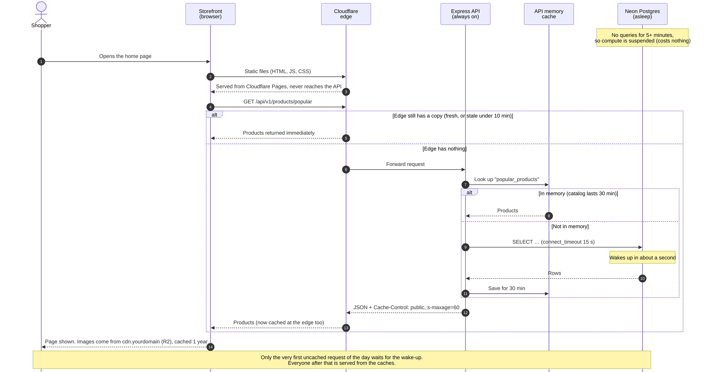

---

## 4. Product search

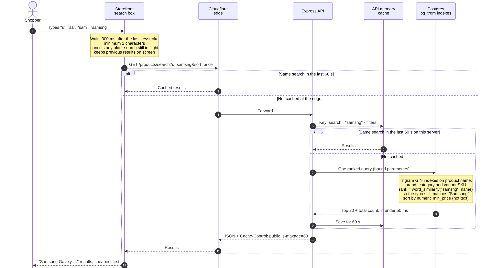

---

## 5. Checkout (no overselling)

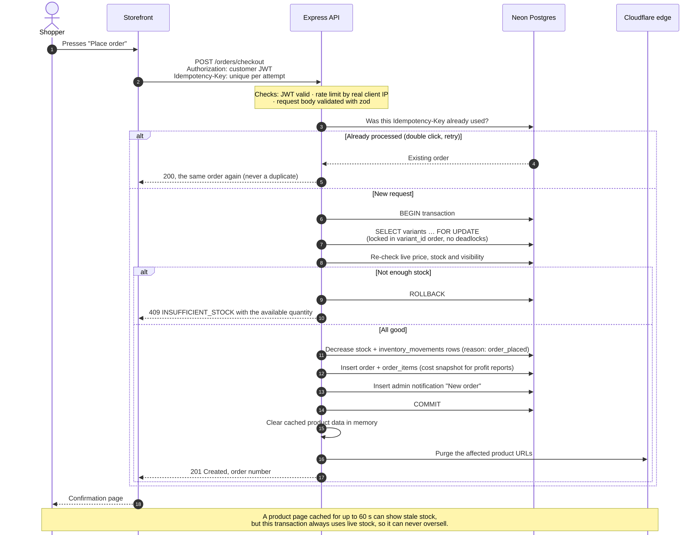

---

## 6. Admin login and an admin request

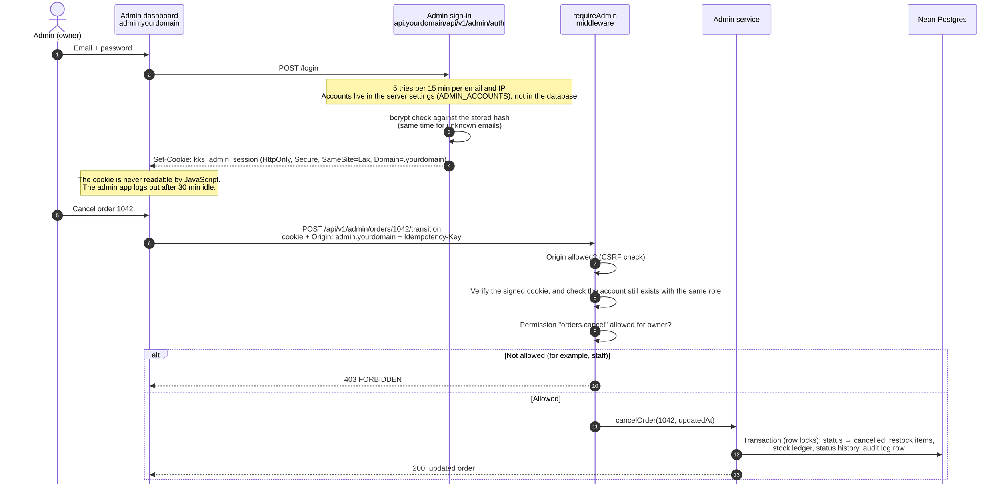

---

## 7. Every stock change goes through one function

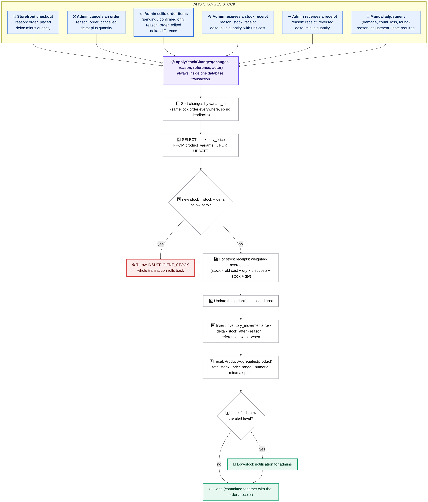

---

## 8. Order state machine

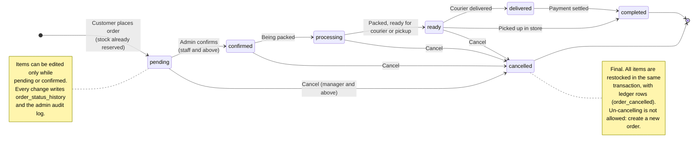

---

## 9. Core data model

Tables after the cleanup. ERP tables (salesman, vendors, installments, account book, expenses) are archived and gone.

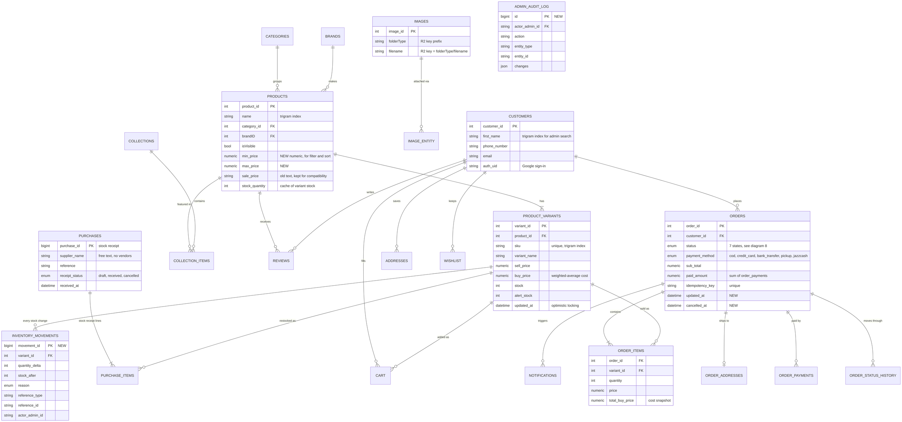

---

## 10. Security layers of one request

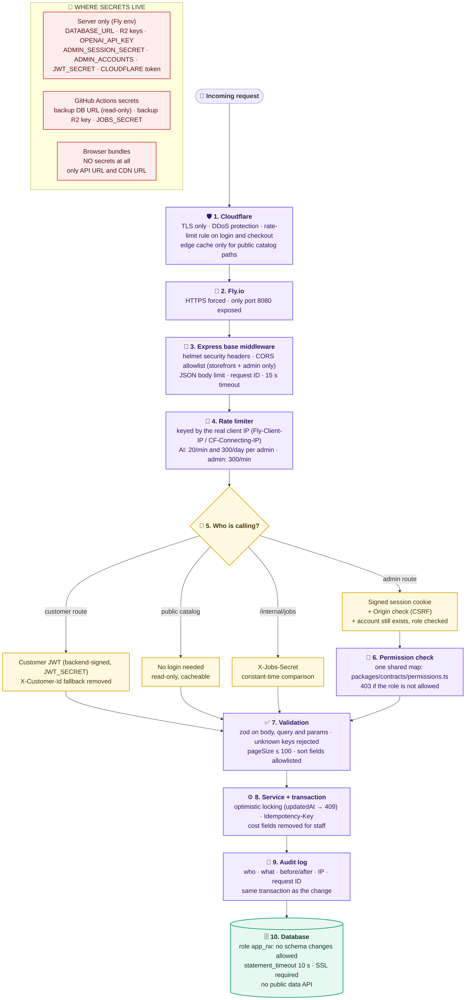

---

## 11. What wakes the database (free compute budget)

Neon free ≈ 100 compute-hours/month. At a fixed 0.25 CU that is **~400 awake hours ≈ 13 hours a day**. The database sleeps after ~5 minutes without queries.

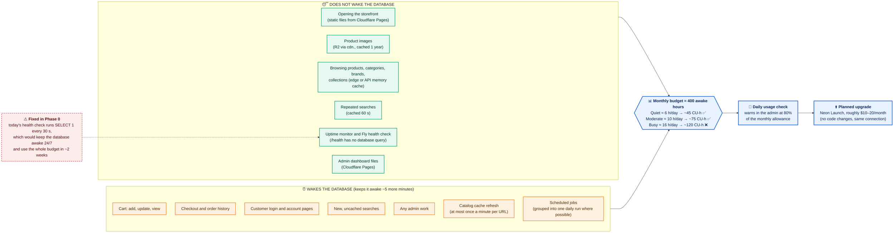

---

## 12. Environments, CI and deployment

```mermaid
%%{init: {"theme": "default", "themeVariables": {"fontSize": "20px"}, "flowchart": {"useMaxWidth": false, "wrappingWidth": 340, "nodeSpacing": 50, "rankSpacing": 75, "curve": "basis"}}}%%
flowchart LR
    DEV["👨‍💻 <b>Developer</b><br/>feature branch<br/>local API + Neon dev branch"]
    DEV -->|"push, open PR"| PR["📝 <b>Pull request</b>"]

    PR --> CI["⚙️ <b>GitHub Actions CI</b><br/>backend: typecheck · lint · unit tests<br/>integration tests on Docker Postgres<br/>authz matrix: every admin route × role<br/>admin + storefront: typecheck · lint · build"]

    CI -->|"pass"| PREV["🔍 <b>Preview deploys</b><br/>Cloudflare Pages preview URL per PR<br/>(storefront + admin)"]
    CI -->|"pass"| STG["🧪 <b>Staging</b><br/>Fly staging app (scales to zero, ~$0)<br/>Neon dev branch · R2 test prefix"]
    STG --> E2E["🎭 <b>Playwright end-to-end tests</b><br/>+ k6 load test before cutover<br/>(100 virtual users, 15 min)"]

    PR -->|"you merge"| MAIN["🌳 <b>main branch</b>"]
    MAIN --> MIG["🗃️ <b>Release step</b><br/>prisma migrate deploy<br/>(additive changes only: expand → contract)"]
    MIG --> FLYP["🚀 <b>Fly production</b><br/>rolling deploy · /health check<br/>1 always-on machine, Singapore"]
    MAIN --> PAGESP["🌍 <b>Cloudflare Pages production</b><br/>storefront + admin"]
    FLYP --> NEONP[("🗄️ <b>Neon production</b><br/>production data")]

    subgraph SAFETY["🛟 SAFETY NET"]
        direction TB
        BK["🌙 Nightly pg_dump<br/>read-only role → encrypted → R2 kks-private<br/>keep 30 daily + 12 monthly"]
        RT["🔁 Restore test<br/>into a throwaway Neon branch<br/>every quarter"]
        MON["📈 Sentry errors · uptime monitor<br/>Fly metrics · daily usage check"]
    end

    NEONP -.-> BK
    BK -.-> RT
    FLYP -.-> MON

    classDef step fill:#E8F1FF,stroke:#2F6FDB,stroke-width:2px,color:#0B2A5B
    classDef test fill:#FFF8E1,stroke:#E0A800,stroke-width:2px,color:#4A3800
    classDef prod fill:#E6F8F0,stroke:#0F9D6B,stroke-width:2px,color:#063D29
    classDef safe fill:#F4F4F5,stroke:#71717A,stroke-width:2px,color:#18181B
    class DEV,PR,MAIN,MIG step
    class CI,PREV,STG,E2E test
    class FLYP,PAGESP,NEONP prod
    class BK,RT,MON safe
```

---

## 13. Production cutover day

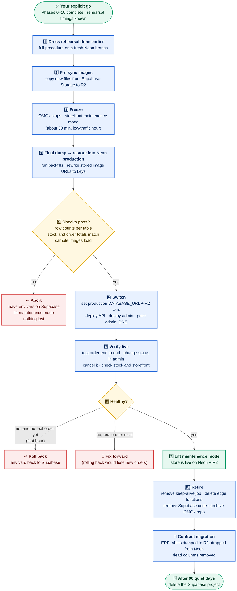

---

## 14. Delivery timeline

The start date is a placeholder: Phase 1 begins when the checklist in [plan.md section 0](plan.md) is done.

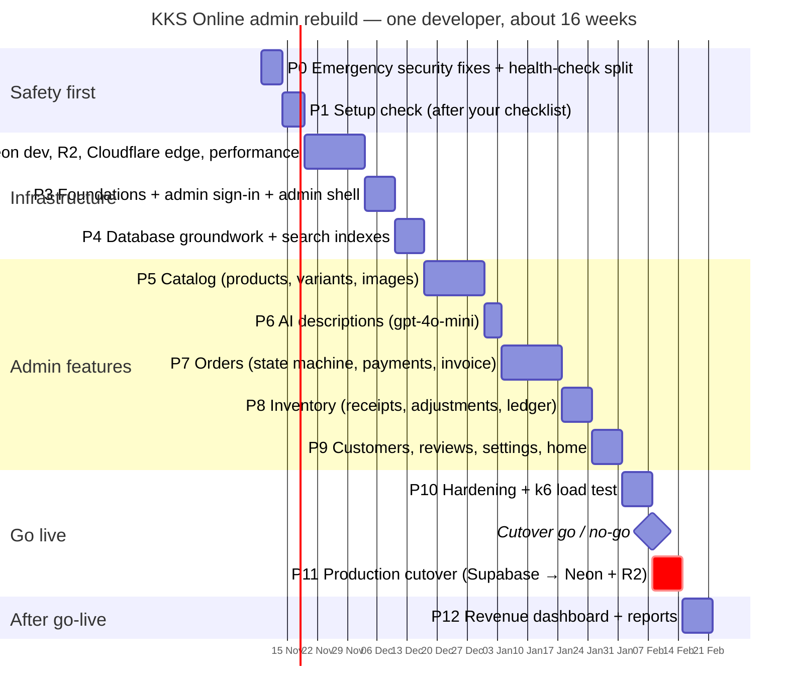
